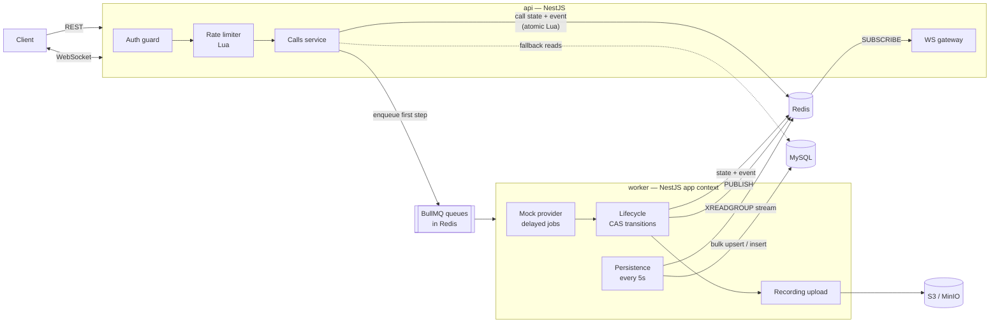

# Mock Communications Service

An async **REST + WebSocket** service that simulates a calling platform. Clients start calls, and each call moves through a randomized lifecycle on its own:

```
QUEUED → RINGING → ANSWERED   → COMPLETED
                 ↘ UNANSWERED ↗
```

The service keeps call state globally in Redis, enforces per-API-key **concurrency** and **calls-per-second** limits, and streams every state change over WebSockets. When a call completes, a background job uploads a recording to S3. It's deployed live on Railway (see [Live demo](#live-demo)) and runs locally with Docker Compose.

**Stack:** NestJS 11 (Node 22, TypeScript) · MySQL 8.4 (TypeORM) · Redis 7 · BullMQ · object storage (AWS S3 in production, configured through the `S3_*` variables; MinIO locally) · `ws` · Prometheus + Grafana (optional, local)

---

## Contents

1. [Live demo](#live-demo)
2. [Run locally with Docker](#run-locally-with-docker)
3. [Architecture](#architecture)
4. [API reference](#api-reference)
5. [WebSocket](#websocket)
6. [Design decisions](#design-decisions)
7. [Project structure](#project-structure)
8. [Configuration](#configuration)
9. [Testing](#testing)
10. [Observability](#observability)
11. [Using real AWS S3](#using-real-aws-s3)
12. [Trade-offs and future work](#trade-offs-and-future-work)

---

## Live demo

The service is deployed and usable at:

**`https://api-production-82563.up.railway.app`**

- Health check (no key needed): [https://api-production-82563.up.railway.app/health](https://api-production-82563.up.railway.app/health)
- WebSocket URLs use `wss://`. Always connect with the `ws_url` returned by `POST /calls`.
- The deployment runs the `api` and `worker` services on Railway, with managed MySQL and Redis.
- Recordings go to a **private AWS S3 bucket**: one silent mock MP3 is uploaded per completed call, and clients download it through a short-lived signed link.

> **API keys:** every request except `/health` needs `Authorization: Bearer <your API key>`. Production keys aren't published here; they are shared separately with the submission.

### Try it

```bash
export API=https://api-production-82563.up.railway.app
export KEY='<your API key>'

# 1. Start a call
curl -s $API/calls -X POST \
  -H "Authorization: Bearer $KEY" -H 'Content-Type: application/json' \
  -d '{"from":"+14155550100","to":"+14155550101","metadata":{"order_id":42}}'
# → {"call_id":"…","status":"QUEUED","ws_url":"wss://api-production-82563.up.railway.app/ws/calls/…?token=…","ws_token_expires_at":"…"}

# 2. Watch it live: paste the ws_url from step 1 exactly as returned
npx wscat -c '<ws_url>'

# 3. Poll it, see its full timeline
curl -s $API/calls/<call_id>        -H "Authorization: Bearer $KEY"
curl -s $API/calls/<call_id>/events -H "Authorization: Bearer $KEY"

# 4. After it completes, download the recording through its signed URL
curl -s -o recording.mp3 "$(curl -s $API/calls/<call_id> -H "Authorization: Bearer $KEY" \
  | python3 -c 'import sys,json;print(json.load(sys.stdin)["recording"]["url"])')"

# 5. Platform metrics
curl -s $API/metrics -H "Authorization: Bearer $KEY"
```

Every call lasts at least 30 seconds (answered: 33–49 s, unanswered: 30–41 s), which leaves time to connect to the WebSocket. For a single command that creates a call and connects to it straight away, see [End-to-end test on production](#end-to-end-test-on-production).

Quoting tips:
- Keep `$API` and `$KEY` inside **double** quotes or unquoted. Inside single quotes the shell doesn't expand them.
- Don't build the WebSocket URL from `$API` (that gives `ws:/https://…`). Use the returned `ws_url`, which already has the right `wss://` scheme and token.

---

## Run locally with Docker

**Prerequisite:** Docker with Compose v2.

```bash
docker compose up --build
```

This starts `mysql`, `redis` and `minio`, runs the one-shot `migrate` service (migrations plus seed keys), and then starts `api` on http://localhost:3000 and the `worker`. Locally, recordings go to MinIO instead of AWS S3.

Two development API keys are seeded. They are for **local use only** and don't work on the live deployment:

| Key | Role |
|---|---|
| `dev_client_key_change_me` | client |
| `dev_admin_key_change_me`  | admin |

> Production uses its own randomly generated keys. For any other deployment, set `SEED_ADMIN_API_KEY` / `SEED_CLIENT_API_KEY` to your own values, or leave them unset to have random keys generated and printed once in the `migrate` logs.

The commands from [Try it](#try-it) work locally too, with:

```bash
export API=http://localhost:3000
export KEY=dev_client_key_change_me
```

Locally the `ws_url` starts with `ws://localhost:3000`, and the signed recording URL points at MinIO (`http://localhost:9000`). The MinIO console is at http://localhost:9001 (user and password: `minioadmin`).

### Running outside Docker (for development)

```bash
pnpm install
docker compose up -d mysql redis minio   # infrastructure only
cp .env.example .env                     # then set S3_ENDPOINT=http://localhost:9000
pnpm db:bootstrap                        # migrations + seed keys
pnpm start:dev                           # API
pnpm start:worker:dev                    # worker (second terminal)
```

---

## Architecture



- **`api`** handles HTTP and WebSockets only. `POST /calls` never touches MySQL: it authenticates (Redis cache), reserves a rate-limit slot (one Lua script), stores the call (one Lua script) and enqueues the first provider step.
- **`worker`** runs every background job:
  - mock provider progression (BullMQ **delayed jobs**, so a call keeps progressing after a restart and work is shared across replicas)
  - recording uploads
  - the periodic Redis → MySQL flush
- **Fan-out:** the worker `PUBLISH`es each event. Every API replica subscribes and forwards the event to its own WebSocket clients, so both sides scale horizontally.
- **Storage split:** Redis holds live state. MySQL holds durable history.

---

## API reference

Every endpoint except `/health` requires `Authorization: Bearer <API_KEY>`. Errors always look like `{"error": "<message>"}`. Validation errors add a `details` array.

| Method | Path | Description |
|---|---|---|
| `POST` | `/calls` | Start a call. Returns `201` with `call_id` and `ws_url`. **`429 {"error":"Rate limit exceeded"}`** when a limit is hit. |
| `GET` | `/calls/:id` | Current call state: live from Redis, from MySQL once the call has aged out of Redis. |
| `GET` | `/calls/:id/events` | Full ordered lifecycle timeline, for debugging or showing clients. |
| `POST` | `/calls/:id/ws-token` | Fresh WebSocket URL for an existing call, e.g. to reconnect. |
| `GET` | `/metrics` | JSON: total, active, CPS, uploads, rejections. |
| `GET` | `/metrics/prometheus` | Prometheus text format. **Admin only.** |
| `POST` | `/admin/api-keys` | Create a key, with optional per-key limits. **Admin only.** The raw key is returned **once**. |
| `GET` | `/admin/api-keys` | List keys. Returns prefix and limits only; secrets are never shown. **Admin only.** |
| `PATCH` | `/admin/api-keys/:id` | Change name, limits (`null` means use the default) or `is_active`. Applies immediately. **Admin only.** |
| `DELETE` | `/admin/api-keys/:id` | Soft-revoke a key. It stops working immediately. **Admin only.** |
| `GET` | `/health` | Liveness/readiness (Redis + MySQL). **No auth.** |

**Access rules:** a client key can only see its own calls. Other tenants' calls return `404`, so their IDs aren't disclosed. An admin key can see every call.

### `POST /calls`

Request:

```json
{ "from": "+14155550100", "to": "+14155550101", "metadata": { "any": "json ≤ 4KB" } }
```

- Numbers must be E.164. Unknown fields are rejected.
- Optional header `Idempotency-Key: <string>`. A retry with the same key returns the original call with `200` and `Idempotent-Replayed: true` instead of creating a second call. Keys are scoped per API key and remembered for 24 hours.

Response (`201`):

```json
{
  "call_id": "703e94fd-fb35-46fa-bfc0-fba13923fee3",
  "status": "QUEUED",
  "ws_url": "wss://api-production-82563.up.railway.app/ws/calls/703e94fd-…?token=5GQ8mC…",
  "ws_token_expires_at": "2026-09-30T09:34:02.248Z"
}
```

### `GET /calls/:id`

```json
{
  "call_id": "703e94fd-fb35-46fa-bfc0-fba13923fee3",
  "status": "COMPLETED",
  "outcome": "ANSWERED",
  "from": "+14155550100",
  "to": "+14155550101",
  "metadata": { "order": 42 },
  "provider": "mock",
  "timestamps": {
    "queued_at": "2026-09-30T08:34:02.240Z",
    "ringing_at": "2026-09-30T08:34:04.619Z",
    "answered_at": "2026-09-30T08:34:07.407Z",
    "unanswered_at": null,
    "completed_at": "2026-09-30T08:34:15.416Z"
  },
  "recording": {
    "status": "UPLOADED",
    "url": "https://<bucket>.s3.<region>.amazonaws.com/recordings/703e….mp3?X-Amz-Signature=…",
    "url_expires_at": "2026-09-30T09:34:26.122Z"
  },
  "last_event_sequence": 5
}
```

`recording` is `null` until the call completes. After that its `status` is `PENDING`, then `UPLOADED` or `FAILED`. As the spec requires, every completed call gets a recording, including unanswered ones. See [Recordings for unanswered calls](#recordings-for-unanswered-calls-spec-interpretation) for the more realistic alternative and how to switch to it. The bucket is private, and `url` is a presigned link that expires after 1 hour by default. The file is a few seconds of silent MP3 (the same mock recording for every call).

### `GET /calls/:id/events`

```json
{
  "call_id": "703e94fd-…",
  "events": [
    { "sequence": 1, "type": "CALL_CREATED",   "from_status": null,       "to_status": "QUEUED",    "payload": null, "occurred_at": "…02.240Z" },
    { "sequence": 2, "type": "STATUS_CHANGED", "from_status": "QUEUED",   "to_status": "RINGING",   "payload": null, "occurred_at": "…04.619Z" },
    { "sequence": 3, "type": "STATUS_CHANGED", "from_status": "RINGING",  "to_status": "ANSWERED",  "payload": null, "occurred_at": "…07.407Z" },
    { "sequence": 4, "type": "STATUS_CHANGED", "from_status": "ANSWERED", "to_status": "COMPLETED", "payload": null, "occurred_at": "…15.416Z" },
    { "sequence": 5, "type": "RECORDING_UPLOAD_SUCCEEDED", "payload": { "attempt": 1, "recording_key": "recordings/703e….mp3" }, "occurred_at": "…15.520Z" }
  ]
}
```

Event types:
- `CALL_CREATED`
- `STATUS_CHANGED`
- `TRANSITION_SKIPPED`: a duplicate or stale job was rejected. Useful for debugging retries.
- `RECORDING_UPLOAD_SUCCEEDED`
- `RECORDING_UPLOAD_FAILED`: the payload carries `attempt`, `error` and `final`.

### `GET /metrics`

```json
{
  "total_calls": 3009, "active_calls": 3, "cps": 2, "cps_avg_10s": 1.4,
  "completed_calls": { "answered": 1543, "unanswered": 1466 },
  "uploads": { "succeeded": 3009, "failed": 0, "pending": 0 },
  "rate_limit_rejections": { "cps": 7, "concurrency": 1 }
}
```

`cps` is the number of new calls platform-wide in the last complete second. `cps_avg_10s` averages the last 10 seconds. These are **observed** rates; the per-key *limit* is separate. All counters live in Redis, so every API replica reports the same numbers.

### Admin example

```bash
export ADMIN_KEY='<your admin API key>'
curl -s $API/admin/api-keys -X POST \
  -H "Authorization: Bearer $ADMIN_KEY" -H 'Content-Type: application/json' \
  -d '{"name":"acme","max_concurrent_calls":10,"max_cps":5}'
# → {..., "api_key":"mcs_YfxkZ4NQ…"}   ← shown once; only its SHA-256 hash is stored
```

---

## WebSocket

Connect to the `ws_url` from `POST /calls`:

```
wss://api-production-82563.up.railway.app/ws/calls/<call_id>?token=<ws_token>
```

Locally the same path is served over `ws://localhost:3000`.

Messages from the server:

```jsonc
{ "type": "snapshot", "call": { /* same shape as GET /calls/:id */ } }      // on connect
{ "type": "event", "event": { "sequence": 2, "type": "STATUS_CHANGED", "from_status": "QUEUED", "to_status": "RINGING", … } }
```

- The server closes the socket (`1000 Call finished`) after the final recording event.
- Clients can use `sequence` and `last_event_sequence` to drop any duplicate that arrives around the snapshot.

**Auth.** The `token` is a random, opaque, **per-call** token stored in Redis. It only grants read access to that one call's updates, so a leaked URL can't create calls or read anything else, and the long-lived API key never appears in a URL or access log.
- The token is valid for 1 hour, far longer than any call.
- When the call completes it is cut to a 5-minute grace period.
- Already-open sockets are never cut off; the token is only checked at the handshake.
- Server-side clients can send `Authorization: Bearer <API_KEY>` on the upgrade request instead of a token.
- Bad credentials are rejected during the HTTP upgrade (`401`/`404`). An unauthenticated socket is never accepted.

The endpoint uses the plain `ws` library rather than socket.io, so any standard WebSocket client works: browsers, `wscat`, Postman, Python.

---

## Design decisions

### Rate limiting: one atomic Lua script

`reserve-call-slot.lua` runs as a single atomic Redis operation. It:
1. prunes the sliding windows,
2. checks **concurrency**: a ZSET of active call IDs per key,
3. checks **CPS**: a sliding-window log, a ZSET of request timestamps from the last 1000 ms,
4. and only if both pass, reserves both.

What this guarantees:
- **No check-then-act race.** 50 simultaneous requests against a limit of 3 admit exactly 3; this is covered by an integration test.
- **Nothing to roll back.** A request rejected for CPS never takes a concurrency slot.
- **Exact CPS.** A sliding window can't be burst at a second boundary the way a fixed window can. At limits this small the log holds at most `max_cps` entries per key, so memory is negligible.
- **Leak-proof slots.** They are freed on `COMPLETED`, and any slot older than `RATE_LIMIT_STALE_SLOT_MS` is pruned, so a crashed job can't hold one forever.
- **Consistent clock.** The script reads Redis `TIME`, so clock skew between API replicas doesn't matter.

A call counts as **active** from `QUEUED` until `COMPLETED`.

### Call state: compare-and-set plus an event log in one step

`append-call-event.lua` is the **only** way call state changes. In one atomic step it:
- validates the transition as a compare-and-set against the current status,
- updates the call hash,
- assigns the next sequence number,
- appends the event to the call's event list and to a global Redis Stream,
- maintains the active-call set and counters.

The consequences:
- A state change can never happen without its event being recorded.
- BullMQ delivers jobs **at least once**, so a job may run twice. A retried or duplicated job can't move a call backwards or complete it twice. It's logged as `TRANSITION_SKIPPED`, and the completion follow-ups (free the slot, queue the upload) are idempotent, so they safely run again if a worker crashed halfway.

### Persistence: batched and append-only

The spec asks for live state in Redis with periodic persistence. Every 5 seconds the worker drains the event stream through a **consumer group**:

- **`call_events`**: each event is bulk-inserted with `INSERT IGNORE`. The table is append-only with no row locks, and the `(call_id, sequence)` unique key makes replays harmless.
- **`calls`**: written only from events that carry a snapshot: created, completed, recording finished. Only the latest snapshot per call is kept, then everything goes out as one bulk `INSERT … ON DUPLICATE KEY UPDATE`. Intermediate states (RINGING, ANSWERED) never rewrite the row, so each call costs about 2–3 row writes in total instead of one per transition.
- Both writes share one transaction, and stream entries are acknowledged only after commit. If a worker crashes mid-batch, the entries stay pending and are reclaimed (`XAUTOCLAIM`) and re-applied idempotently.

Reads:
- `GET /calls/:id` reads Redis first and falls back to MySQL after `CALL_STATE_TTL_SECONDS`.
- `/events` reads the call's Redis event list, which is complete while the call is hot, so it doesn't lag behind the flush.

### Recordings for unanswered calls: spec interpretation

**Current behaviour, which follows the spec literally.** The spec says: *"When a call reaches COMPLETED, trigger a background job that uploads a static mock audio file"*. This service does exactly that for **every** completed call, including calls that went `UNANSWERED → COMPLETED`, so an unanswered call ends up with an uploaded recording.

**Ideal behaviour.** On a real telephony platform an unanswered call has no audio, so there is nothing to record. Only answered calls should get a recording:

| Outcome | Upload job | `recording` in `GET /calls/:id` | WebSocket closes after |
|---|---|---|---|
| ANSWERED → COMPLETED | queued | `PENDING` → `UPLOADED` / `FAILED` | `RECORDING_UPLOAD_SUCCEEDED` (or the final `RECORDING_UPLOAD_FAILED`) |
| UNANSWERED → COMPLETED | **not queued** | `null` | the `COMPLETED` event |

**What to change to get the ideal behaviour.** It's a small, contained change, because every completion follow-up lives in one place (`CallLifecycleService`):

1. **`src/modules/call-lifecycle/call-lifecycle.service.ts`, in `transition()`.** Mark the recording as pending only for answered calls. `from` is the outcome on the way into COMPLETED:
   ```ts
   const isFinal = to === CallStatus.COMPLETED;
   const hasRecording = isFinal && from === CallStatus.ANSWERED;
   const result = await this.callState.transition(callId, from, to, {
     fields: hasRecording ? { recording_status: RecordingStatus.PENDING } : {},
   });
   ```
2. **Same file, `onCompleted()`.** Queue the upload only for answered calls. The other follow-ups (release the rate-limit slot, shorten WebSocket tokens) still run for every call:
   ```ts
   await Promise.all([
     this.rateLimiter.release(call.apiKeyId, call.id),
     this.callUpdates.expireTokensForCall(call.id),
     ...(call.outcome === CallStatus.ANSWERED
       ? [this.recordings.enqueueUpload(call.id)]
       : []),
   ]);
   ```
3. **`src/modules/call-updates/call-updates.gateway.ts`, in `dispatch()`.** Close the socket on `COMPLETED` for unanswered calls, since no recording event will follow. `CallStatus` needs importing there:
   ```ts
   const isLast =
     event.type === CallEventType.RECORDING_UPLOAD_SUCCEEDED ||
     (event.type === CallEventType.RECORDING_UPLOAD_FAILED &&
       event.payload?.final === true) ||
     (event.toStatus === CallStatus.COMPLETED &&
       event.fromStatus === CallStatus.UNANSWERED);
   ```
4. **Tests, in `call-lifecycle.service.spec.ts`.** Add a case asserting that `UNANSWERED → COMPLETED` does **not** call `enqueueUpload` and does not set `recording_status`, while still releasing the slot. Update the existing COMPLETED case to use the ANSWERED path.

Nothing else needs to change:
- **Database:** `recording_status` is already nullable, so unanswered calls keep `NULL`.
- **API:** `GET /calls/:id` already returns `recording: null` when there is no recording status.
- **Metrics:** after the change, `uploads.succeeded` should match `completed_calls.answered`.

### Swappable providers

```ts
interface CallProvider {
  readonly name: string;
  dial(call: CallRecord): Promise<void>;   // hand off to the carrier, return fast
}
```

The provider reports progress by calling `CallLifecycleService.transition(callId, from, to)`. `MockCallProvider` does this from BullMQ delayed jobs; a Twilio or Plivo provider would do it from its status webhook. Everything that has to happen on a state change lives in the lifecycle service, not in the provider: CAS, events, WebSocket publish, slot release, upload.

To add a provider:
1. Implement the interface.
2. Add a case to the factory in `call-provider.module.ts`.
3. Set `CALL_PROVIDER=<name>`.

Storage works the same way through `StorageProvider`, which today is S3 or MinIO.

### Other choices

- **One auth model.** API keys carry a `role` (`admin` | `client`). A global guard handles every route, `@Public()` and `@Roles()` opt routes out or restrict them, and keys are stored as SHA-256 hashes. The auth lookup is cached in Redis for 60 seconds. Unknown keys are negatively cached for 10 seconds, so an invalid-key flood can't hammer MySQL. The cache is invalidated immediately when a key changes.
- **Database access lives in injected repositories.** MySQL: `ApiKeyRepository`, `CallRepository`, `CallEventRepository`. Redis: `CallStateRepository`, `CallEventStreamRepository`. Services never touch TypeORM or raw Redis keys.
- **Metrics never fail a call.** Metric writes are best-effort in the hot path.

---

## Project structure

```
src/
├── main.ts / app.module.ts          # API process (REST + WebSocket)
├── worker.ts / worker.module.ts     # Worker process (lists every BullMQ processor it runs)
├── config/                          # Joi-validated env → typed config tree (single source of defaults)
├── common/                          # domain types (call state machine, events), constants, decorators, filter
├── infrastructure/
│   ├── database/                    # TypeORM entities, repositories, migrations, bootstrap (migrate + seed)
│   ├── redis/                       # connection, Lua scripts, CallState / EventStream repositories
│   ├── queue/                       # BullMQ connection
│   └── storage/                     # StorageProvider interface + S3/MinIO implementation
└── modules/                         # one feature per module: *.module / *.service / *.controller / *.spec
    ├── auth/                        # guard, key authentication, admin API key endpoints
    ├── calls/                       # POST /calls, GET /calls/:id, ws-token
    ├── call-history/                # GET /calls/:id/events
    ├── call-lifecycle/              # provider-agnostic state machine driver
    ├── call-provider/               # CallProvider interface + mock implementation (+ processor)
    ├── call-updates/                # pub/sub, WS tokens, WebSocket gateway
    ├── rate-limiter/                # concurrency + CPS limits
    ├── idempotency/                 # Idempotency-Key support
    ├── recordings/                  # upload job (+ processor)
    ├── persistence/                 # Redis stream → MySQL batch writer (+ processor)
    ├── metrics/                     # JSON + Prometheus metrics, HTTP latency interceptor
    └── health/
test/redis-scripts.e2e-spec.ts       # Lua scripts vs a real Redis (race conditions)
docker/                              # Prometheus config, Grafana datasource + dashboard
```

Modules only get a controller when they expose HTTP endpoints. Worker-only concerns have a `*.processor.ts` instead.

### Database schema

The initial migration is `src/infrastructure/database/migrations/1727700000000-initial-schema.ts`.

| Table | Purpose | Notable columns / indexes |
|---|---|---|
| `api_keys` | Keys and per-key limits | `key_hash` (unique, SHA-256); `role`; `max_concurrent_calls` / `max_cps` (NULL means use the default); `is_active`; `revoked_at` |
| `calls` | Durable call record | status, outcome, timestamp per status, `recording_status` / `recording_key` / `recording_url`; index `(api_key_id, status)`, `(created_at)` |
| `call_events` | Append-only audit trail | `(call_id, sequence)` unique; `event_type`, from/to status, JSON `payload`, `occurred_at` (ms); index `(event_type, occurred_at)` |

---

## Configuration

Every variable is validated at startup with Joi, and the app refuses to start on a bad value. The full list with comments is in [`.env.example`](.env.example). Docker Compose has working defaults for all of them.

| Variable | Default | Purpose |
|---|---|---|
| `RATE_LIMIT_DEFAULT_MAX_CONCURRENT` / `_MAX_CPS` | `3` / `2` | Defaults for keys without an override |
| `MOCK_QUEUED_DELAY_MIN_MS` / `_MAX_MS` | `5000` / `7000` | QUEUED → RINGING |
| `MOCK_RINGING_DELAY_MIN_MS` / `_MAX_MS` | `8000` / `12000` | RINGING → ANSWERED / UNANSWERED |
| `MOCK_TALK_DURATION_MIN_MS` / `_MAX_MS` | `20000` / `30000` | ANSWERED → COMPLETED (talk time) |
| `MOCK_UNANSWERED_DELAY_MIN_MS` / `_MAX_MS` | `17000` / `22000` | UNANSWERED → COMPLETED |
| `MOCK_ANSWER_PROBABILITY` | `0.5` | Chance a call is answered |
| `PERSISTENCE_FLUSH_INTERVAL_MS` | `5000` | Redis → MySQL flush period |
| `CALL_STATE_TTL_SECONDS` | `3600` | How long finished calls stay in Redis |
| `WS_TOKEN_TTL_SECONDS` / `_GRACE_SECONDS` | `3600` / `300` | WebSocket token lifetime, and how long it stays valid after completion |
| `RECORDING_UPLOAD_ATTEMPTS` | `5` | Upload retries (exponential backoff) |
| `S3_*` | MinIO (local) | Production uses AWS S3 through these variables: bucket, region, access keys, empty endpoints. See [Using real AWS S3](#using-real-aws-s3) |
| `PUBLIC_BASE_URL` | request host | Base used to build `ws_url` |

---

## Testing

```bash
pnpm test                               # 108 unit tests — every service, processor, guard, gateway handshake and config
docker compose up -d redis && pnpm test:e2e   # Lua scripts against a real Redis
pnpm lint
```

The integration suite proves the concurrency guarantees against a real Redis:
- 50 racing requests admit **exactly** the limit.
- A CPS rejection doesn't use a concurrency slot.
- Of 20 racing duplicate transitions, exactly one applies.
- A stale job can't move a call backwards.

### End-to-end test on production

One command creates a call and immediately opens its WebSocket, so you watch the whole lifecycle live:

```bash
export API=https://api-production-82563.up.railway.app
export KEY='<your API key>'
npx wscat -c "$(curl -s $API/calls -X POST -H "Authorization: Bearer $KEY" -H 'Content-Type: application/json' -d '{"from":"+14155550100","to":"+14155550101","metadata":{"order":42}}' | python3 -c 'import sys,json;print(json.load(sys.stdin)["ws_url"])')"
```

Expected output over the next 30–50 seconds:

```
Connected (press CTRL+C to quit)
< {"type":"snapshot","call":{…"status":"QUEUED"…}}
< {"type":"event","event":{"sequence":2,"type":"STATUS_CHANGED","from_status":"QUEUED","to_status":"RINGING",…}}
< {"type":"event","event":{"sequence":3,"type":"STATUS_CHANGED","from_status":"RINGING","to_status":"ANSWERED",…}}
< {"type":"event","event":{"sequence":4,"type":"STATUS_CHANGED","from_status":"ANSWERED","to_status":"COMPLETED",…}}
< {"type":"event","event":{"sequence":5,"type":"RECORDING_UPLOAD_SUCCEEDED","payload":{"attempt":1,"recording_key":"recordings/….mp3"},…}}
Disconnected (code: 1000, reason: "Call finished")
```

About half the calls go `RINGING → UNANSWERED → COMPLETED` instead. If you get `Invalid API key` or an empty URL, check that `KEY` is set in the current terminal. Creating more than 2 calls per second, or having more than 3 active at once, returns `429 {"error":"Rate limit exceeded"}` by design.

The same command works against the local stack with `API=http://localhost:3000` and `KEY=dev_client_key_change_me`.

### Load test (single API container, laptop, local Docker)

3,000 `POST /calls` requests at 50 concurrent connections, using a key with raised limits:

| Throughput | p50 | p95 | p99 | Result |
|---|---|---|---|---|
| **~2,600 req/s** | 15 ms | 31 ms | 91 ms | 3,000 × `201` |

The worker took all 3,000 calls through their full lifecycle and recording upload. MySQL ended with exactly 3,009 `calls` and 15,045 `call_events` rows (5 per call), so nothing was lost or duplicated.

---

## Observability

Prometheus and Grafana run with the local Docker stack; they aren't part of the live deployment. The live API still serves `/metrics` (JSON) and `/metrics/prometheus` (admin key).

```bash
docker compose --profile observability up --build
```

- **Grafana:** http://localhost:3001 (anonymous view access; admin/admin). It opens with a pre-provisioned *Mock Communications Service* dashboard: active calls, CPS, calls per key, outcomes, rate-limit rejections, uploads, p95 latency by route.
- **Prometheus:** http://localhost:9090. It scrapes `/metrics/prometheus` every 5 seconds using the dev admin key.

Both are free, open-source images; no account is needed.

---

## Using real AWS S3

The live deployment stores recordings this way, with the variables below set in the hosting platform. To use S3 locally too, create a `.env` next to `docker-compose.yml`:

```dotenv
S3_BUCKET=your-bucket
S3_REGION=ap-southeast-2
S3_ENDPOINT=                # empty → AWS
S3_PUBLIC_ENDPOINT=         # empty → AWS
S3_FORCE_PATH_STYLE=false
S3_ACCESS_KEY_ID=AKIA…
S3_SECRET_ACCESS_KEY=…
```

- Keep the bucket **private**. Clients only ever get presigned URLs.
- `S3_REGION` must be the bucket's actual region; a mismatch fails uploads with *"The bucket you are attempting to access must be addressed using the specified endpoint"*.
- Use a dedicated IAM user whose policy allows only `s3:PutObject` and `s3:GetObject` on `arn:aws:s3:::your-bucket/recordings/*`.
- `.env` is gitignored. Never commit keys.

---

## Trade-offs and future work

- **Redis is the live source of truth.** AOF persistence is on, and MySQL receives every event within about 5 seconds. A total Redis loss would lose at most that window plus the state of in-flight calls. For stronger durability, run Redis with replication, or write `CALL_CREATED` synchronously at the cost of hot-path latency.
- **Single Redis primary.** The rate-limit script is Cluster-safe (hash-tagged keys). The call script touches global keys (stream, active set), so Redis Cluster would need those sharded per slot.
- **The event stream is capped** (`EVENT_STREAM_MAX_LENGTH`, default 1M) as a memory guard. That cap only matters if MySQL is down long enough for 1M events to back up.
- **Recordings on unanswered calls.** These are uploaded to match the spec's wording; realistically only answered calls should have one. See [Recordings for unanswered calls](#recordings-for-unanswered-calls-spec-interpretation) for the four-step change.
- **Possible next steps:**
  - webhooks to client URLs on state change
  - OpenAPI/Swagger docs
  - per-key metrics endpoint for clients
  - retention jobs for old `call_events`
  - a real carrier provider behind `CallProvider`

The official `minio/minio` images are no longer publicly pullable, so Compose uses Bitnami's legacy MinIO build (`bitnamilegacy/minio`). It's the same S3-compatible server, and it's only used for local development.
